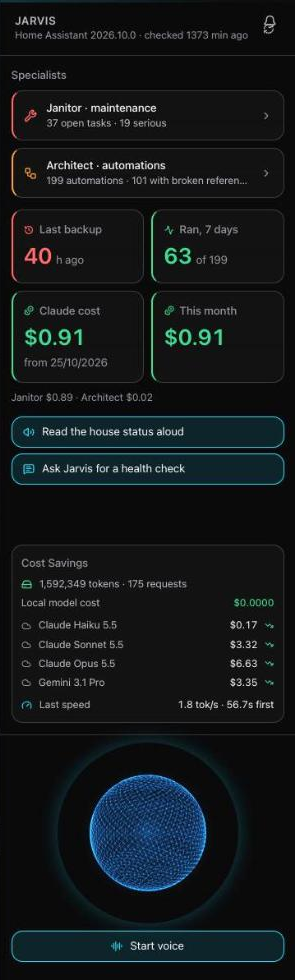
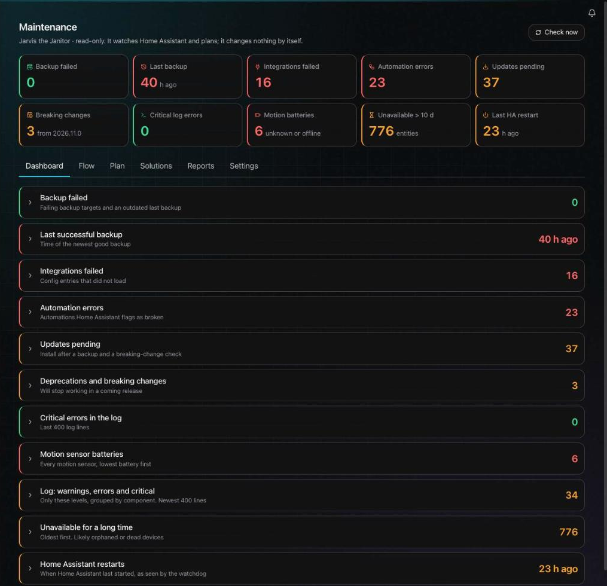
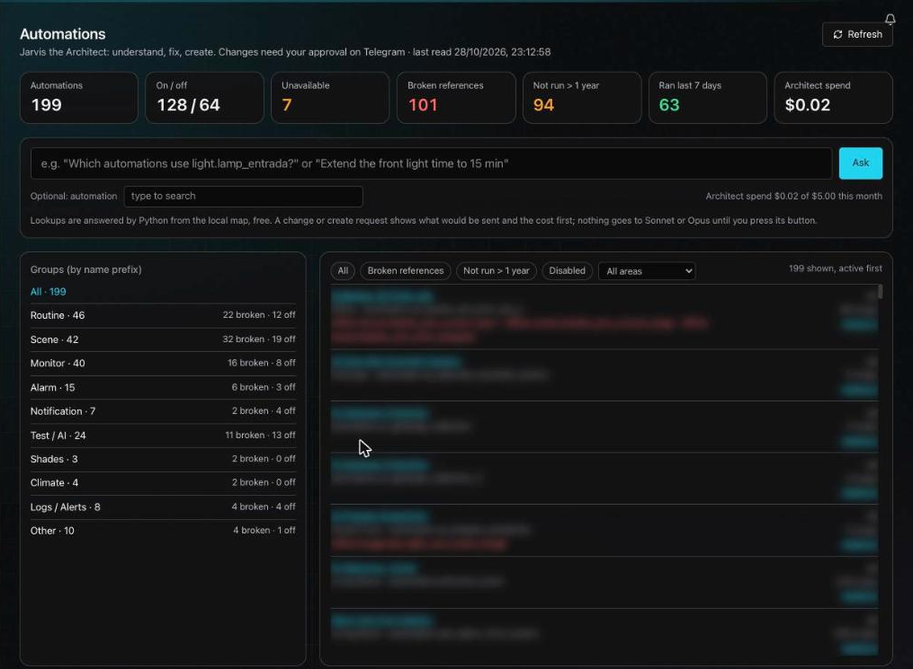

<div align="center">
  

  # Jarvis for Home Assistant

  **A local-first AI maintenance team for a smart home.**
  One assistant that watches your Home Assistant, explains what is wrong in plain English,
  and changes nothing without your approval.

  <sub>A fork of <a href="README.openjarvis.md">OpenJarvis</a> (Stanford), Apache 2.0. Status: working pilot, built in the open.</sub>
</div>

---

## What it is

Home Assistant installations grow: hundreds of automations, thousands of entities, integrations that quietly break, batteries that die, backups that stop. Nobody has time to audit all of it.

This project adds two specialists to a local Jarvis:

| Specialist | Job | Status |
|---|---|---|
| **Jarvis the Janitor** | Watches the house: backups, failed integrations, broken automations, pending updates, deprecations, dead motion-sensor batteries, long-unavailable entities, restarts. Groups the findings into a ranked task list. | Working pilot |
| **Jarvis the Architect** | Understands your automations: which entities each one uses, which references are broken, which have not run in a year, and what a change would touch. Proposes edits as a reviewable diff. | Working pilot, read-only until you enable writes |

Both live in one interface, with a general front page, a voice sphere, and approvals on Telegram.

<p align="center">
  
</p>

## Screenshots

**Maintenance (the Janitor)**: ten KPI cards on top, every finding expandable below.



**Automations (the Architect)**: the whole automation map, grouped, filterable, with the question box on top. Entity names in this screenshot are blurred on purpose.



## Design principles

1. **Local first.** A small local model (Qwen via Ollama) reads and answers from files that Python prepared. It never reasons over raw history and never gets secrets.
2. **Python does the facts, models do the language.** Counts, lookups and diffs are computed in code. A cloud model is used only for judgement, and only when you click.
3. **You trigger every paid call.** Claude (Haiku, Sonnet, Opus) is used on a button press, with the estimated cost shown first, and a monthly budget limit per specialist.
4. **Real cost, visible.** The front page shows accumulated Claude cost, split Janitor / Architect, with a reset in Settings. The Cost Savings box compares the local model against Claude and Gemini for the same tokens.
5. **Nothing changes without approval.** An edit is a diff with a restore step. It needs a recent backup, goes to Telegram with Approve / Reject buttons, re-reads the automation right before writing (and refuses if it changed), writes, then reads it back. Simulation mode is the default.
6. **Secrets stay out.** Tokens and passwords are redacted before anything reaches a model, and are never written to the logs.

## How a change flows

```
Ask in plain English
      |
Python finds the automation and its context (free, instant)
      |
Recommend (Sonnet, on your click)  ->  an "edits" block + risk
      |
Checks: automation exists, entities exist, old values match, backup is fresh
      |
Telegram: Approve / Reject   ->   run (simulation by default)   ->   read back + restore step
```

## Roadmap and open points

Built: Janitor (checks, plan, solutions library, reports), Architect (map, lookups, Recommend, approval and apply path), general front page, cost counter, voice sphere, Telegram approvals, HA editor links.

Next:
- First small **live** edit, chosen and watched by a human
- Architect **Create** mode: new automations delivered disabled
- User-defined bundles of automations (tags)
- Daily scheduled check and a weekly report
- Export of the automation map to Google Drive for use in a Claude project
- **Jarvis Mobile**: a small PWA reachable through Tailscale
- Cost comparison panel that includes cloud spend per specialist
- More specialists beside the Janitor and the Architect
- Cleanup of Home Assistant deprecations (2026.11)

Open questions: whether to split Architect into its own Telegram bot, how to expose the read limit of the Home Assistant config reader, and how far automatic fixes should ever go.

## Run it

This is OpenJarvis plus the `agents/` modules for Home Assistant. Follow the OpenJarvis install notes in [README.openjarvis.md](README.openjarvis.md), then:

```bash
jarvis gui        # the interface
```

You also need a Home Assistant instance with a long-lived token, the `ha-mcp` server, and (optionally) an Anthropic key and a Telegram bot for the cloud and approval features. Settings live in `~/.openjarvis/`; nothing secret belongs in the repository.

## Safety note

This software can edit a real smart home. It ships in simulation mode. Keep backups, read every diff, and try it on a copy first.

## License

Apache 2.0, inherited from [OpenJarvis](README.openjarvis.md).
